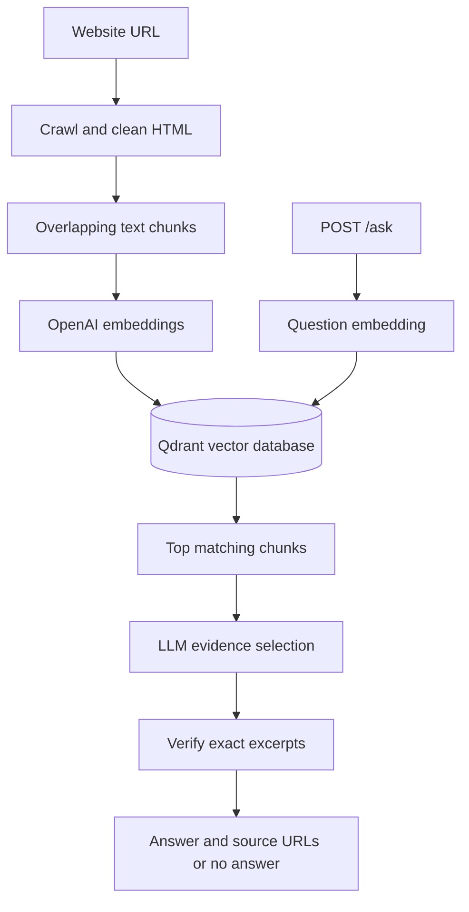

# Q&A Support Bot (RAG)

A small Python REST API that answers support questions using only text crawled from a website. It uses OpenAI embeddings, Qdrant vector search, and an OpenAI chat model to select supporting excerpts. No frontend or unrelated functionality is included.

## Architecture



- `app/crawler.py`: bounded breadth-first, same-origin HTML crawler; observes robots.txt, removes navigation, scripts, and other boilerplate.
- `app/chunking.py`: 240-word windows with 40-word overlap, with a character cap and deterministic IDs.
- `app/providers.py`: OpenAI embedding/chat adapters and Qdrant REST adapter.
- `app/ingest.py`: batch embeddings and vector upserts; one new collection per ingestion.
- `app/rag.py`: similarity retrieval (top 5, cosine score at least 0.25), evidence selection and verification.
- `app/main.py`: FastAPI `POST /ask` endpoint.
- `tests/test_rag.py`: deterministic unit and API tests.

## Requirements

Python 3.10+, Docker with Compose (or an existing Qdrant server), and an OpenAI API key with access to the configured models. API usage may incur charges. Use a public website you are authorized to crawl and send its content to your model provider. This project does not bypass authentication or robots.txt.

## 1. Install dependencies

```bash
python -m venv .venv
```

Activate it using `.venv\Scripts\Activate.ps1` on Windows PowerShell or `source .venv/bin/activate` on Linux/macOS, then:

```bash
python -m pip install -r requirements-dev.txt
```

## 2. Configure providers

Start Qdrant locally:

```bash
docker compose up -d
```

Set environment variables in the terminal (do not commit your key). `.env.example` is a reference, not an automatically loaded file.

Windows PowerShell:

```powershell
$env:OPENAI_API_KEY="your-real-api-key"
$env:QDRANT_COLLECTION="website_support_v1"
```

Linux/macOS:

```bash
export OPENAI_API_KEY="your-real-api-key"
export QDRANT_COLLECTION="website_support_v1"
```

Defaults: `QDRANT_URL=http://localhost:6333`, `OPENAI_EMBEDDING_MODEL=text-embedding-3-small`, `OPENAI_CHAT_MODEL=gpt-4.1-mini`. For hosted Qdrant, set `QDRANT_URL` and `QDRANT_API_KEY` instead of starting Docker. Keep the same embedding model and collection for ingestion and answering.

## 3. Crawl, clean, chunk, embed and store

```bash
python -m app.ingest https://example.com/ --max-pages 10
```

Replace the example URL with your chosen authorized website. The example domain is only a small demonstration, not a rich support knowledge base. Choose the final canonical URL (e.g. the correct www host) because external-origin redirects are not followed. The crawler limits fetched pages, respects robots.txt and waits between requests. Only HTML text is indexed, not JavaScript-rendered pages or PDFs. On success the CLI prints the indexed chunk count.

A collection stores chunk vectors and URL/text payloads. Use a **new** `QDRANT_COLLECTION` name for a recrawl or embedding model change; ingestion refuses an existing collection to avoid mixing stale data. Complete ingestion before pointing the API at the new collection. Failed writes trigger best-effort cleanup; if cleanup fails, remove the incomplete collection manually. Run only one ingestion process per collection.

## 4. Start the API

In the same configured terminal:

```bash
python -m uvicorn app.main:app --host 127.0.0.1 --port 8000
```

## 5. Test with curl or Postman

Linux/macOS:

```bash
curl -X POST http://127.0.0.1:8000/ask \
  -H 'Content-Type: application/json' \
  -d '{"question":"What is this domain used for?"}'
```

Windows PowerShell (use a file to avoid shell quoting differences):

```powershell
Set-Content -Path question.json -Value '{"question":"What is this domain used for?"}' -Encoding ascii
curl.exe -X POST http://127.0.0.1:8000/ask -H "Content-Type: application/json" --data-binary "@question.json"
```

Postman: choose POST, URL `http://127.0.0.1:8000/ask`, Body > raw > JSON, and send `{"question":"What is this domain used for?"}`. Adjust the question for your chosen website.

Response format (illustrative, from the local test fixture):

```json
{
  "answer": "Refund within 30 days.",
  "sources": [{"url": "https://site.test/refunds", "quote": "Refund within 30 days."}]
}
```

Ask an unrelated question and expect an abstention when no supporting evidence is selected:

```json
{"answer":"I could not find an answer in the crawled website content.","sources":[]}
```

Blank or invalid questions return HTTP 422; provider/index errors return HTTP 503. The LLM selects verbatim excerpts, and the API checks them against retrieved chunks before returning them. This prevents invented answer text, but relevance and correctness of the source itself are not guaranteed. The answer is intentionally extractive rather than free-form synthesis.

## 6. Automated tests

```bash
python -m pytest -q
```

Six tests passed during development: crawling/cleaning, overlap, ingestion/retrieval/API behavior, fabricated evidence rejection, ingestion rollback, and provider HTTP contracts. A running Uvicorn instance was also tested with curl using deterministic local test providers: grounded answer (200), no answer (200), blank question (422). Real OpenAI and Qdrant calls were not tested in the build environment because network access and Docker were unavailable. Run steps 2–5 to verify live integration before submission.

## Design decisions and extensibility

The crawler, chunker, provider adapters and RAG orchestration are separated. `Embedder`, `Retriever` and `Generator` protocols allow providers to be replaced independently. Ingestion streams pages and batches embeddings; Qdrant provides persistent indexed vector search and can be deployed separately. API workers can share a completed collection. This is a local educational backend, not a production service: no authentication, rate limiting, background job system or distributed ingestion coordination. The crawler is a trusted-operator CLI, not an endpoint accepting arbitrary URLs. Tune retrieval thresholds for the selected website; a similarity score alone is not proof of relevance.

## Submission

Create a public GitHub repository with an initial README on `main`. Create `feedback` from that initial commit **before** uploading the project. Push the project files to `main`, then open the first pull request with base `feedback` and compare `main`. Submit the PR #1 URL; keep it open for feedback unless instructed otherwise. Do not commit credentials or generated local files.
